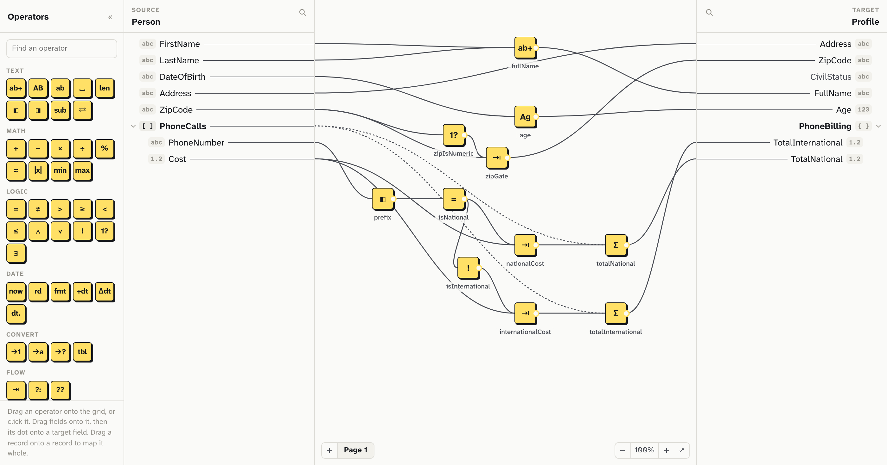

# Crosswalk

A visual mapper for JSON. Show a source and a target side by side, then map one onto the other by dragging fields across, through operators that transform the values on the way. The map is saved as plain JSON, and runs in JavaScript or .NET.

**[Documentation](https://crosswalkjs.github.io/crosswalk/)** · **[Playground](https://crosswalkjs.github.io/crosswalk/playground)** · [Changelog](CHANGELOG.md)



## What's in it

| Package | What it does |
|---|---|
| [`@crosswalkjs/canvas`](https://www.npmjs.com/package/@crosswalkjs/canvas) | The editor, to embed in your app. Plain DOM, so it works with React, Vue, Svelte, Solid, Angular, Astro or none. |
| [`@crosswalkjs/core`](https://www.npmjs.com/package/@crosswalkjs/core) | Runs a map on your data, in the browser or Node. Also checks maps, and reads and writes XML and flat files. |
| [`Crosswalk.Core`](https://www.nuget.org/packages/Crosswalk.Core) | Runs the same maps in .NET 8 and later. |

## Quick start

```bash
npm install @crosswalkjs/canvas @crosswalkjs/core
```

Show the editor, and save the map whenever it changes:

```ts
import { createMapper } from "@crosswalkjs/canvas";

createMapper(document.getElementById("mapper")!, {
  document: map,
  onChange: (next) => save(next),
});
```

Run the map on some data:

```ts
import { createTransform } from "@crosswalkjs/core";

const transform = createTransform(map); // checks the map once
const profile = transform(person);
```

Or in .NET:

```csharp
var transform = MapTransform.Create(File.ReadAllText("person-to-profile.map.json"));
JsonObject profile = transform.Run(JsonNode.Parse(personJson));
```

The [getting started guide](https://crosswalkjs.github.io/crosswalk/docs/getting-started) goes from an empty page to a running map, and each framework has its own page.

## Features

- **41 built-in operators** for text, maths, logic, dates, conversions and totals, and your own, including ones that wait on an API.
- **Schemas** from JSON Schema, OpenAPI, XSD, or a sample of the data.
- **XML and flat files** in and out: CSV, fixed-width, HL7, X12 and EDIFACT.
- **Repeating data**: loops over arrays, totals across them, and filters.
- **Large maps** split into pages and sub-maps, with notes.
- **A live preview** of the output as you edit, and problems flagged as you go.
- **A read-only view** for showing a map on a page.
- **On a phone**, the map as a list of fields, each showing how it's made step by step, with its value.
- **14 themes**, or your own, and every piece of the editor's wording can be changed.

## Status

Crosswalk is at 0.1. It works, but the API may change before 1.0.

## Contributing

See [CONTRIBUTING.md](CONTRIBUTING.md) for building and testing it locally.

## Licence

MIT
